<p align="center">
  
</p>

<h1 align="center">Coffee Delivery</h1>

<p align="center">
  SPA de cafeteria com catálogo, carrinho, checkout com consulta de CEP e confirmação de pedido.<br />
  Projeto Final 05 da disciplina <strong>Single Page Application</strong>: React + TypeScript + IA.
</p>

<p align="center">
  <strong>🌐 Aplicação publicada:</strong> ✏️ <em>(cole aqui o link da Vercel)</em> ·
  <strong>🎨 Figma:</strong> ✏️ <em>(cole aqui o link do arquivo)</em>
</p>

---

## Sumário
- [Objetivo](#objetivo)
- [Funcionalidades](#funcionalidades)
- [Telas](#telas)
- [Stack](#stack)
- [Como rodar](#como-rodar)
- [Arquitetura](#arquitetura)
- [Decisões principais](#decisões-principais)
- [Branding com IA](#branding-com-ia)
- [Qualidade e acessibilidade](#qualidade-e-acessibilidade)
- [Uso de IA no desenvolvimento](#uso-de-ia-no-desenvolvimento)
- [Deploy](#deploy)
- [Documentação](#documentação)
- [Limitações conhecidas](#limitações-conhecidas)

## Objetivo
Permitir que o cliente de uma cafeteria escolha cafés, monte um carrinho, informe o endereço (com preenchimento automático pelo CEP), escolha a forma de pagamento e receba a confirmação de um **pedido fictício**, tudo sem recarregar a página. O foco acadêmico é consolidar componentes, Props, Hooks, Context API, `useReducer`, imutabilidade, rotas, formulários com validação, persistência local, temas, testes e documentação SPEC.

## Funcionalidades
| | Requisito |
| --- | --- |
| ☕ | Catálogo com os 14 cafés do Figma: imagem, tags, descrição e preço (RF-01) |
| ➕ | Quantidade de 1 a 99 antes de adicionar; o mesmo café soma na mesma linha (RF-02, RF-03) |
| 🛒 | Contador no Header com a soma das **unidades** (RF-04) |
| ✏️ | No checkout: aumentar, diminuir (mínimo 1) e remover itens, com totais na hora (RF-05) |
| 💾 | Carrinho, tema e último pedido salvos no `localStorage`, com validação dos dados lidos (RF-06) |
| 🧭 | Rotas `/`, `/checkout` e `/success` com React Router, sem recarregar a página (RF-07) |
| 📮 | Endereço validado com Zod e **preenchido pelo ViaCEP**, com tratamento de CEP inválido, inexistente, carregamento e API fora do ar (RF-08) |
| 💳 | Pagamento obrigatório: crédito, débito ou dinheiro, só informativo (RF-09) |
| 🧮 | Subtotal, entrega fixa de R$ 3,50 e total, calculados em centavos (RF-10) |
| ⛔ | Não confirma com carrinho vazio, formulário inválido ou CEP sendo consultado; feedback acessível (RF-11) |
| ✅ | Tela de sucesso com endereço, previsão e pagamento, a partir de um *snapshot* do pedido (RF-12, RF-13) |
| 🌗 | Tema claro e escuro, salvo e com o tema do sistema como padrão (RF-14) |
| 📱 | Layout *mobile first* testado de 320 a 1440 px (RF-15) |
| 🐔 | Logo e mascote criados com IA, no Header, no favicon e no hero (RF-16) |

## Telas
### Desktop
| | Claro | Escuro |
| --- | --- | --- |
| Home | 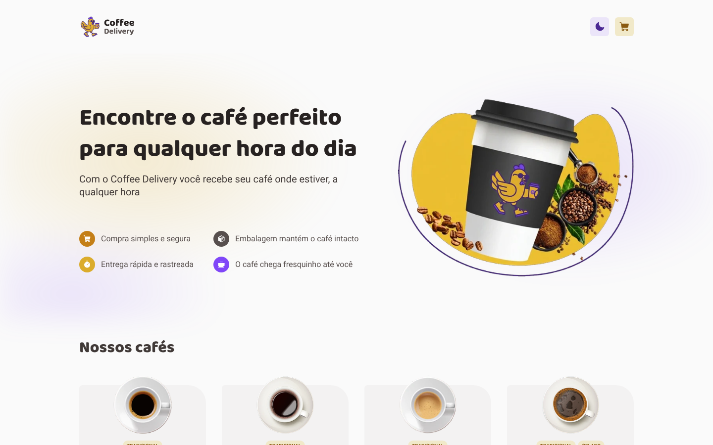 | 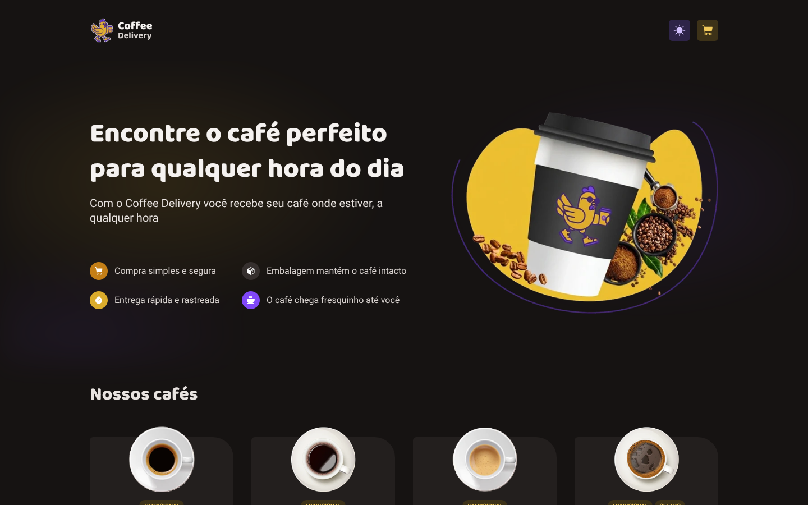 |
| Checkout | 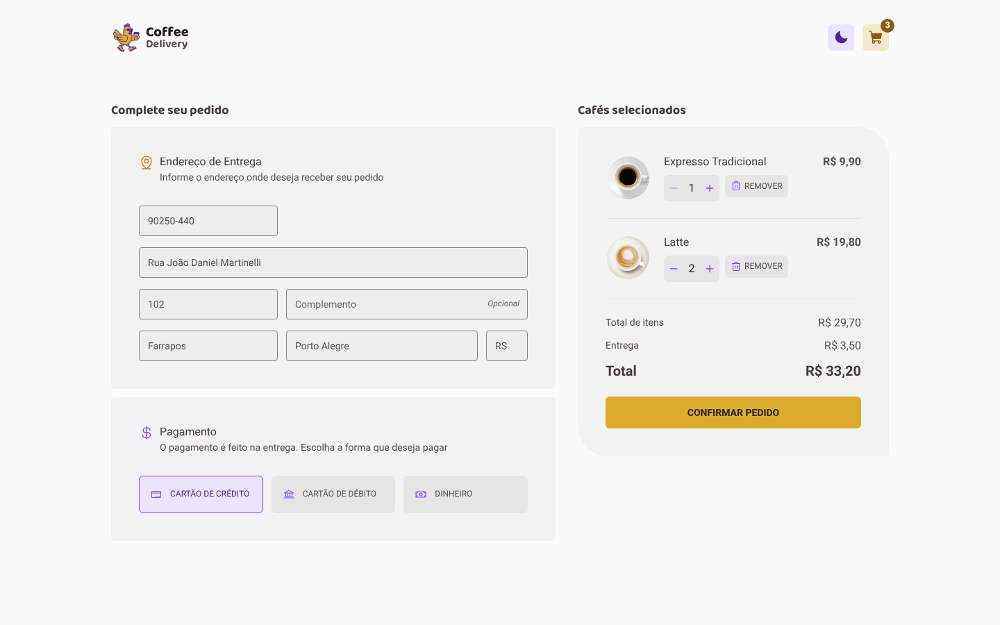 | 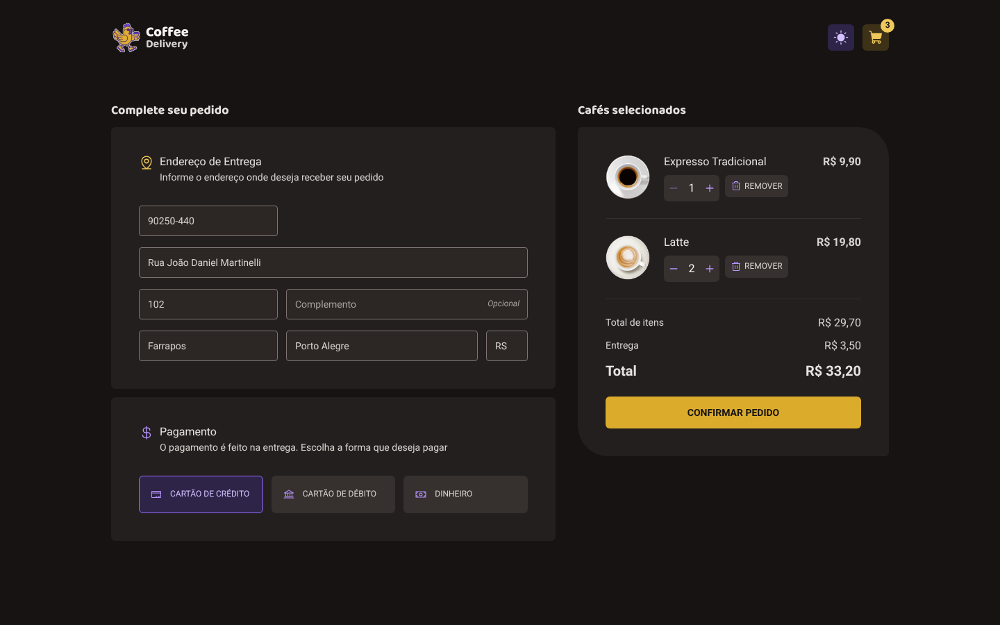 |
| Sucesso | 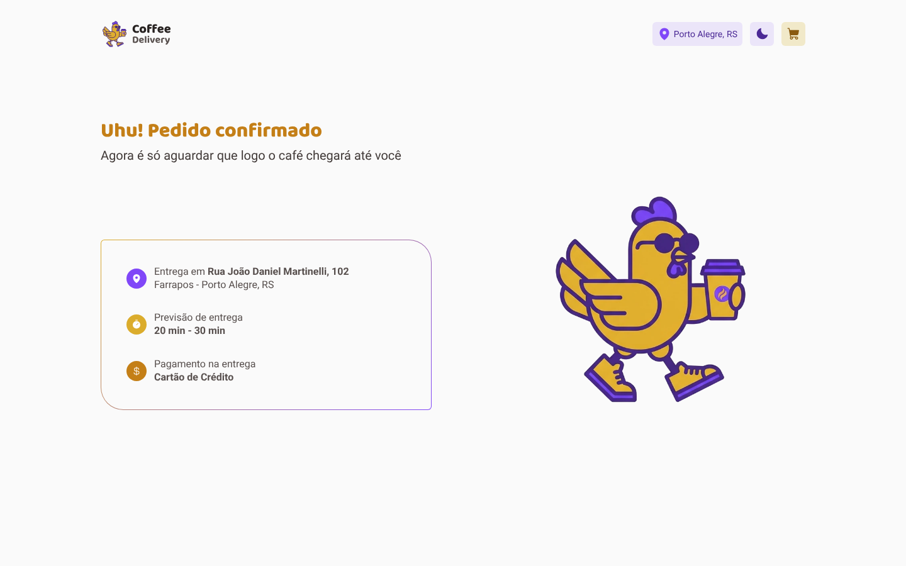 | 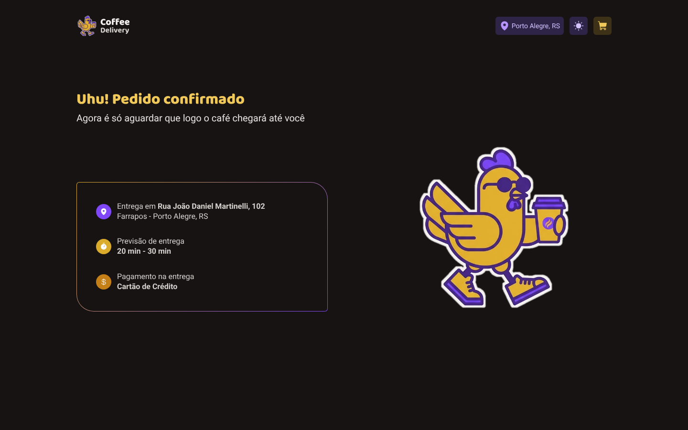 |

### Mobile (390 px)
| Home | Checkout | Sucesso |
| --- | --- | --- |
| 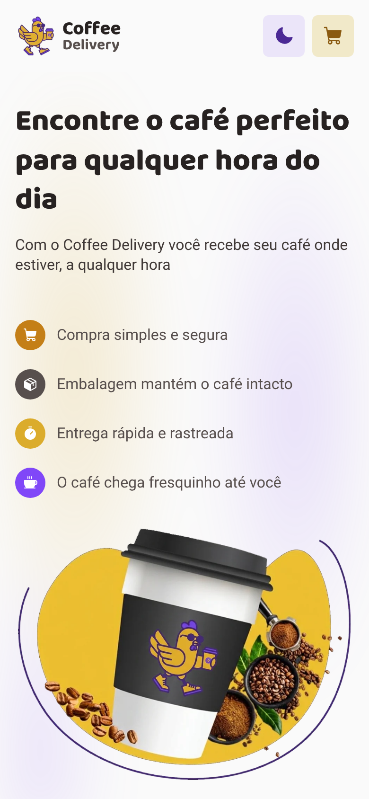 | 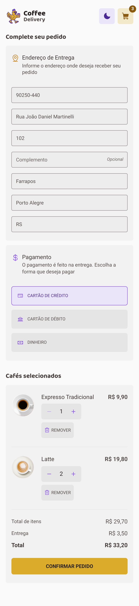 | 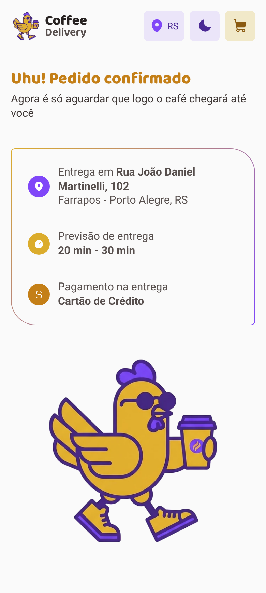 |
| 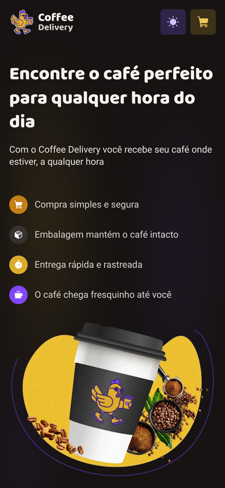 | 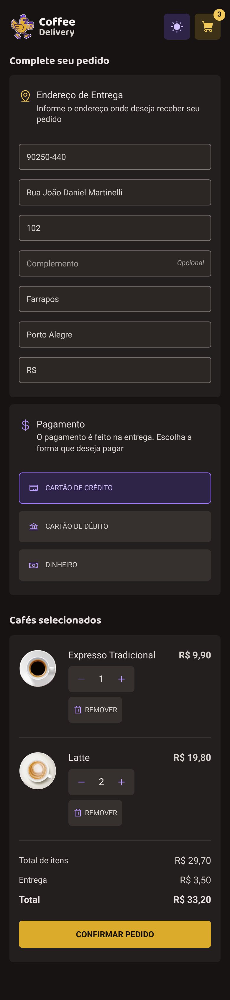 | 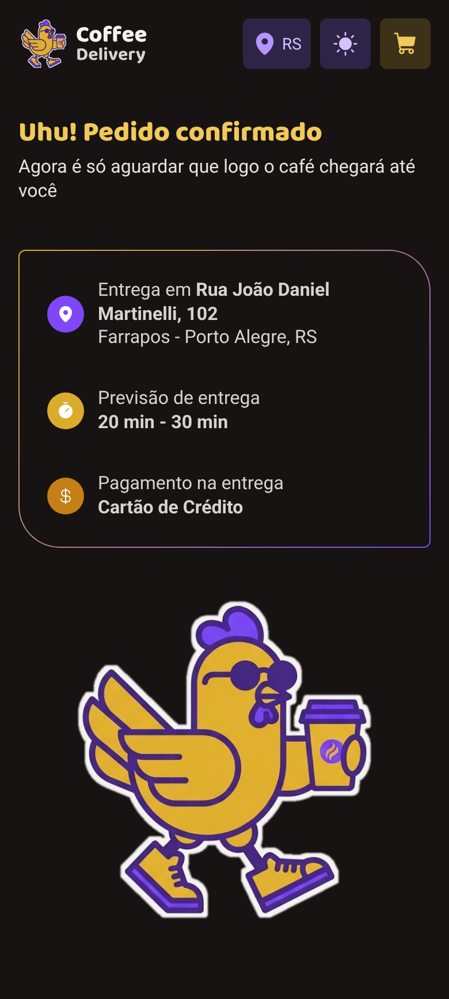 |

## Stack
| Tecnologia | Uso |
| --- | --- |
| React 19 + TypeScript (strict) + Vite | SPA, componentes TSX e tipagem |
| React Router 7 | Rotas, layout com `<Outlet>`, carregamento sob demanda (`lazy`) |
| Context API + `useReducer` | Estado global do carrinho e do tema |
| React Hook Form + Zod 4 | Formulário de endereço e pagamento, validação e tipos |
| styled-components 6 | Estilos e temas claro/escuro com tokens semânticos |
| Phosphor Icons, Fontsource (Baloo 2 e Roboto) | Ícones e fontes hospedadas no projeto |
| ViaCEP | API pública de consulta de CEP |
| Vitest + Testing Library | Testes unitários e de componentes |
| oxlint + Prettier | Lint e formatação |

Justificativas detalhadas em [`docs/TECH_SPEC.md` §1](docs/TECH_SPEC.md).

## Como rodar
**Requisitos:** Node.js **22.12 ou mais novo** e npm.

```bash
git clone https://github.com/ClaudioFJ/coffee-delivery.git
cd coffee-delivery
npm install
npm run dev        # http://localhost:5173
```

| Script | O que faz |
| --- | --- |
| `npm run dev` | Servidor de desenvolvimento |
| `npm run build` | Checagem de tipos + build de produção em `dist/` |
| `npm run preview` | Serve o build de produção localmente |
| `npm run test` | Testes em modo observação |
| `npm run test:run` | Roda todos os testes uma vez |
| `npm run coverage` | Testes + relatório de cobertura |
| `npm run typecheck` | Checagem de tipos (`tsc`) |
| `npm run lint` | Lint (oxlint) |
| `npm run format` | Formata o código (Prettier) |

## Arquitetura
```
src/
├── assets/        imagens dos cafés, mascote e ilustrações
├── components/    UI reutilizável (Header, CoffeeCard, QuantityInput, CartItem, TextField…)
├── contexts/      CartProvider e AppThemeProvider (+ objetos de contexto)
├── data/          catálogo tipado dos 14 cafés
├── hooks/         useCart, useTheme, useLocalStorage, useCepLookup, useRouteFocus…
├── layouts/       DefaultLayout (Header + <Outlet/>)
├── pages/         Home, Checkout, Success, NotFound
├── reducers/      ações e reducer puro do carrinho
├── schemas/       schema Zod do checkout
├── services/      consulta ao ViaCEP
├── styles/        tokens, temas, tipografia, breakpoints, estilos globais
├── tests/         197 testes em 18 arquivos
├── types/         Coffee, CartItem, DeliveryAddress, PaymentMethod, Order
└── utils/         dinheiro, cálculos do carrinho, CEP, pedido, storage
```

**Fluxo do estado global (adicionar ao carrinho):**
```
CoffeeCard ─ onAddToCart('latte', 2) ─► Home ─ useCart().addItem ─► CartProvider
   dispatch({ type: 'ADD_ITEM', payload }) ─► cartReducer (função pura, sem mutação)
   ─► novo estado ─► useMemo recalcula unidades e totais ─► Header e Checkout re-renderizam
   ─► useEffect grava o carrinho no localStorage
```

**Confirmação do pedido:** `confirmOrder` cria um *snapshot* do pedido (itens com nome e preço copiados, endereço, pagamento e totais), salva como "último pedido" e limpa o carrinho. A tela de sucesso lê o snapshot, então continua correta com o carrinho vazio e depois de um F5.

Detalhes em [`docs/TECH_SPEC.md`](docs/TECH_SPEC.md) §2 a §7.

## Decisões principais
| Decisão | Motivo |
| --- | --- |
| "−" desabilitado em 1 no carrinho; para tirar, "Remover" | Evita remoção acidental (DP-01) |
| Entrega fixa de R$ 3,50 | Igual ao Figma, regra simples e testável (DP-02) |
| Valores em centavos | Evita erro de ponto flutuante (`0.1 + 0.2`) (DP-04) |
| Carrinho guarda só `id` + quantidade | Preço e nome sempre vêm do catálogo; itens inexistentes são descartados |
| Campos do ViaCEP continuam editáveis | A API pode devolver dados incompletos (DP-05) |
| Ajustes de cor para acessibilidade | 3 pares do Figma reprovavam no contraste WCAG (TECH_SPEC §8.2) |
| Fontes locais, rotas sob demanda, hero pré-carregado | Desempenho e privacidade (DT-05 a DT-07) |

Todas as decisões estão em [`PRD_SPEC.md` §8.2](docs/PRD_SPEC.md) (DP-01 a DP-13) e [`TECH_SPEC.md` §1](docs/TECH_SPEC.md) (DT-01 a DT-07).

## Branding com IA
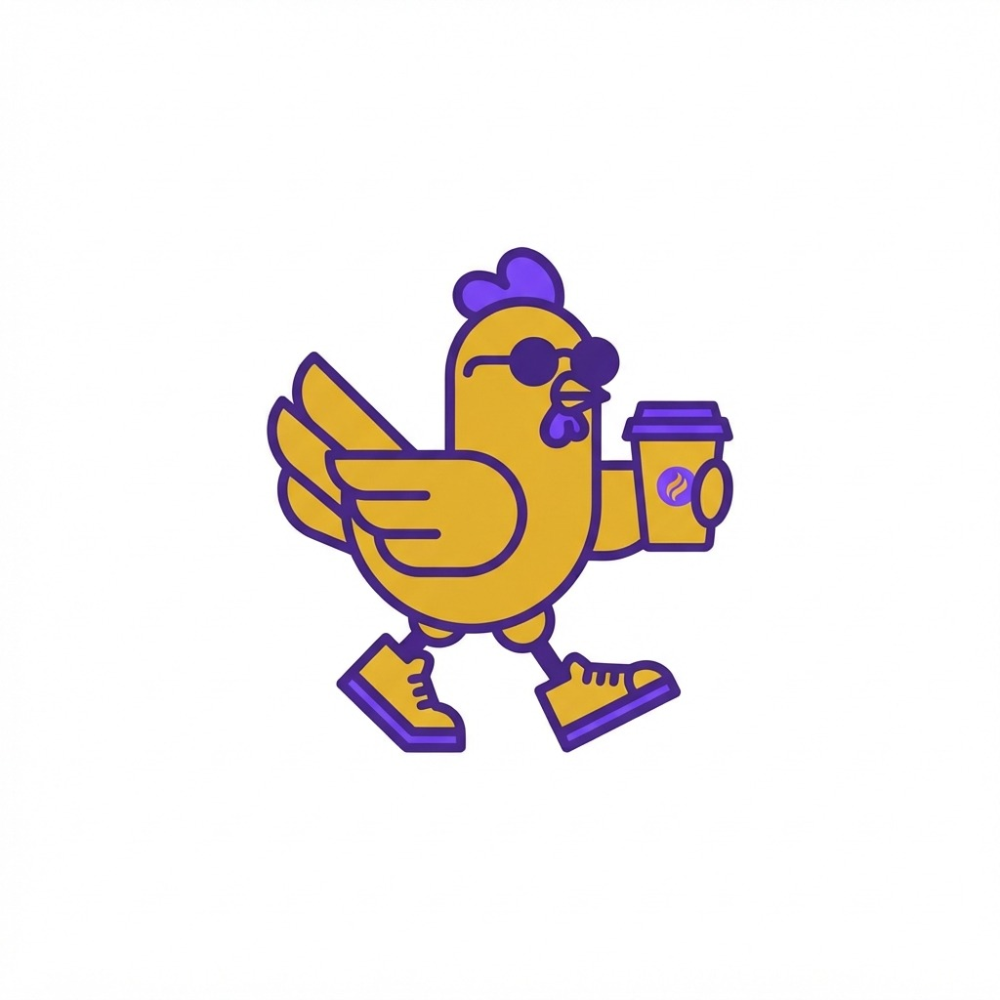

- **Conceito:** uma galinha descolada, de óculos escuros e tênis, andando com um copo de café. Ela comunica *entrega* e personalidade usando a paleta do Figma (amarelo `#DBAC2C` e roxo `#4B2995`).
- **Ferramenta:** ✏️ *(preencher)*
- **Prompt:** em [`docs/BRANDING.md`](docs/BRANDING.md) §2.
- **Curadoria:** remoção de fundo, versão para tema escuro com contorno claro, favicon só com a cabeça (legível em 16 px) e aplicação no copo do hero.
- **Direitos de uso:** ✏️ *(resumir os termos da ferramenta)*

Processo completo, ajustes e testes de legibilidade em [`docs/BRANDING.md`](docs/BRANDING.md).

<br clear="right" />

## Qualidade e acessibilidade
| Verificação | Resultado |
| --- | --- |
| Testes automatizados | **197 testes** em 18 arquivos, todos passando |
| Cobertura de linhas | 97,6% no geral (`utils/` 98%, `reducers/` 93%, `services/` 100%) |
| Contraste WCAG 2.2 AA | 23 pares de cores verificados automaticamente em cada tema (`themes.test.ts`) |
| axe-core (WCAG A/AA) | 0 violações em todas as telas, nos dois temas |
| Lighthouse | Acessibilidade 100 · Boas práticas 100 · SEO 100 · Desempenho 100 (desktop) / 83 (mobile simulado) |
| Responsividade | 5 telas × 4 larguras (320 a 1440 px) × 2 temas, sem rolagem horizontal |
| Teclado | Skip link, foco visível, foco no título a cada troca de página, rádios com setas |

Casos de teste (TC-01 a TC-22) e resultados em [`docs/TECH_SPEC.md` §9](docs/TECH_SPEC.md).

## Uso de IA no desenvolvimento
O projeto foi desenvolvido com o **Claude (Anthropic)** como mentor e par de programação, seguindo as regras de [`AGENTS.md`](AGENTS.md): ler os SPEC antes de codar, trabalhar por tarefas, explicar decisões e validar cada etapa. As interações relevantes (prompt, objetivo, resposta, decisão e evidência) estão em [`docs/AI_USAGE.md`](docs/AI_USAGE.md).

## Deploy
Publicado na **Vercel** a partir deste repositório:
1. Em [vercel.com](https://vercel.com), entre com o GitHub e clique em **Add New → Project**.
2. Importe o repositório `coffee-delivery`. A Vercel detecta o Vite sozinha (build `npm run build`, saída `dist`).
3. Clique em **Deploy**.

O `vercel.json` redireciona todas as rotas para o `index.html`, para o F5 em `/checkout` e `/success` não dar erro 404.

## Documentação
| Documento | Conteúdo |
| --- | --- |
| [`docs/PRD_SPEC.md`](docs/PRD_SPEC.md) | Produto: escopo, fluxos, RF-01 a RF-16, RN-01 a RN-10, decisões |
| [`docs/TECH_SPEC.md`](docs/TECH_SPEC.md) | Técnica: arquitetura, tipos, reducer, rotas, schema, temas, testes |
| [`docs/TASKS_SPEC.md`](docs/TASKS_SPEC.md) | Plano de implementação em 34 tarefas, com status e testes |
| [`AGENTS.md`](AGENTS.md) | Regras para o assistente de IA |
| [`docs/BRANDING.md`](docs/BRANDING.md) | Branding com IA |
| [`docs/AI_USAGE.md`](docs/AI_USAGE.md) | Registro de uso de IA |
| [`docs/CHECKLIST.md`](docs/CHECKLIST.md) | Checklist final do enunciado com evidências |
| [`docs/GUIA-APRESENTACAO.md`](docs/GUIA-APRESENTACAO.md) | Roteiro de estudo para a apresentação |

## Limitações conhecidas
- **Desempenho mobile 83 no Lighthouse** (meta: 90). Em um SPA, a imagem principal só aparece depois que o JavaScript carrega; resolver de vez exigiria pré-renderização (SSG), fora do escopo.
- **Campos sem rótulo visível depois de preenchidos**, por fidelidade ao Figma. O `<label>` existe para leitores de tela.
- **Previsão de entrega fixa** (20 a 30 min) e pagamento apenas informativo: não há backend.
